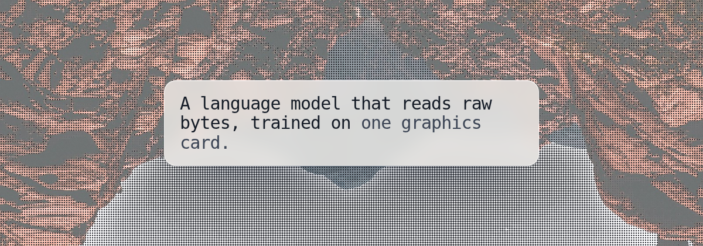

<div align="center">



# 🐹 dormouse

**A byte-level language model that trains on one workstation — with every
claim measured, and every retraction kept.**

[](https://github.com/sehaxe/dormouse/actions/workflows/ci.yml)
[](LICENSE)
[](https://www.python.org)
[](https://developer.nvidia.com/cuda-gpus)
[](https://www.rust-lang.org)

**Two lanes.** `port/` is the live one — config, model, trainer, post-training,
every number on record. `crates/` is the Rust/burn lane, **frozen since
2026-11-07**: it compiles and its tests run, but no new work lands there until
the Python lane's numbers settle. One RTX 5070 Ti (16 GB, sm_120).

**Landing page:** [`site/index.html`](site/index.html) — two themes, a photograph
through a halftone shader, and every number on it computed from the run logs.

</div>

---

## What is this

dormouse trains a **byte-level** LM (vocab 256, no tokenizer) on one 16 GB card.
The live model is a vanilla dense pre-LN transformer — 95,035,200 parameters,
12 unique layers, `d_model` 832 — because a 13.5M dense control beat a 102.7M
KDA/CSA/mHC loop by 0.126–0.37 BPB at equal bytes
([review](docs/reviews/2026-11-06-control-transformer.md)). The frontier arms
still exist as flags, not as the recipe: KDA linear attention, CSA fine + HCA
coarse selection for a 1M context, MoD routing, Engram memory.

The project is **evidence-first**: a mechanism must beat its own removal on
held-out BPB at a fixed budget (`A/B or death`, [`AGENTS.md`](AGENTS.md) §1.2),
every number is published with its config and date, and every retracted claim
stays published as retracted.

## Results

Held-out BPB on **one fixed English window** (`mix4/web_eval.bin`, `off=0`,
196 608 bytes scored). A BPB is only comparable within its window.

| run | BPB | bytes seen | note |
|---|---:|---:|---|
| `flagship3` | 1.5185 | 245.8 MB | `doc_masking=true`, Muon fp32 NS |
| **`e1v4` bytes arm** | **1.4946** | 250.0 MB | `doc_masking=false`, bf16 NS 5 steps |
| `e1v4` patch arm | 3.3007 | 250 MB | **patch unit rejected** at matched bytes |
| uniform byte | 8.000 | — | by definition |

**Retracted** (kept, not deleted): `1.4621` — its window overlapped training
bytes ([audit](docs/reviews/2026-11-08-data-eval-integrity.md)); the pre-Muon-fix
`1.927 @ 98 MB`; and “the Muon fix was worth −0.267 BPB”, which compared two
different mixtures.

**Seed noise:** 1σ ≈ 0.011 BPB at 73.7 MB. Anything below that is not a result.

## What is measured, not assumed

| lever | measured | status |
|---|---|---|
| Muon Newton–Schulz in bf16, 5 steps | **1.92× the step** for +0.01 BPB | ships |
| Muon NS 3 steps | **+0.27 BPB** at `[832, 3072]` | rejected |
| byte-patch unit (8 bytes/position) | 4.6× fewer seconds per byte | **rejected on quality**: the interface, not the codec (equal steps 3.74 vs 2.55) |
| `ns_steps=5`, `muon_state_dtype=bf16` | free | ships |
| 1M context state | **33 MiB per CSA slot** (fine 32 + coarse 1) at `d=1024`, carried **once per iteration** — 99 MiB for the 3-slot loop, 396 MiB on a 12-layer stack; KDA adds ~0.4 MB/slot | segmented training required; a 1M forward has not been run |
| 1B on this card | fits only at b=1: 11.84 GiB with checkpointing ([research](docs/research/2026-11-08-1b-on-one-card.md)) | planned |

The compute target: **275M @ 22 GB** is the Chinchilla point for that budget;
1B needs 80 GB of bytes and ~5 days at the current speed.

## Quick start

```bash
cd port
uv sync
PYTHONPATH=src .venv/bin/python -m dormouse.cli train configs/flagship3_dense.toml \
  --data ../data_local/best/fwedu.bin --eval ../data_local/mix4/web_eval.bin \
  --set steps=30517 --set batch=8 --set seq_len=1024 \
  --set opt=mix --set muon_lr_mult=12 --set lr=3e-4 \
  --set ns_dtype=bf16 --set muon_state_dtype=bf16
```

Gates before a commit:

```bash
bash scripts/gate_fast.sh          # ruff, dead knobs, doc refs
cd port && PYTHONPATH=src .venv/bin/python -m pytest -q
```

## The audits (2026-11-08)

Five read-only audits and two research reports, all committed with their
evidence: [math](docs/reviews/2026-11-08-math-audit.md) ·
[numerics](docs/reviews/2026-11-08-numerics-audit.md) ·
[data/eval integrity](docs/reviews/2026-11-08-data-eval-integrity.md) ·
[CPU perf](docs/reviews/2026-11-08-cpu-perf-audit.md) ·
[deletion](docs/reviews/2026-11-08-deletion-audit.md) ·
[1B on one card](docs/research/2026-11-08-1b-on-one-card.md) ·
[post-training at 1B](docs/research/2026-11-08-post-training-at-1b.md).

They found, among other things: a hierarchical-CSA parent mask that was never
checked (a live crash at 16 KB), two loss firewalls blind to the failure they
exist for, an optimizer whose defaults disagreed with its config, and an eval
window that overlapped training bytes. All are fixed with gates.

## Repo map

| path | what |
|---|---|
| `port/` | the live Python lane: config, model, trainer, post-training, scripts, tests |
| `crates/` | the frozen Rust/burn lane — formula source for the Python model |
| `vendor/` | the vendored forks the frozen lane builds against |
| `docs/` | every document: `research/`, `reviews/`, `architecture/`, `guides/`, `adr/` |
| `site/` | the landing page and its generator |
| `configs/` | flat TOML presets, one per arm |
| `.bulba/plan.md` | the live queue |

## Status, honestly

- The best clean number is **1.4946 BPB at 250 MB** on one English window.
- The **patch unit is rejected**; the 16× story it was going to carry is dead.
- The **1B run needs memory work** (segmented activations, bf16 Muon) and 5 days.
- `docs/reviews/2026-11-08-data-eval-integrity.md` lists the claims that are
  still suspect; `docs/reviews/2026-11-08-deletion-audit.md` lists 10.8k lines
  that already have a verdict and 15.5k lines of Rust that duplicate the live path.
