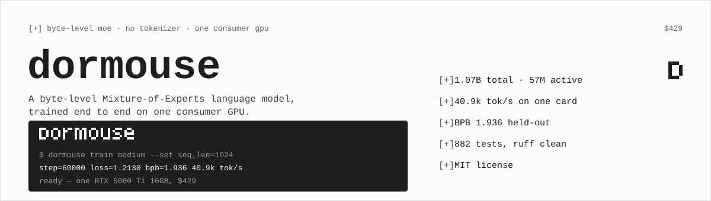

<p align="center">
  
</p>

# 🐹 dormouse

[](https://github.com/sehaxe/dormouse/actions/workflows/ci.yml)

**English** · [Русский](README.ru.md)

**dormouse** is a from-scratch, byte-level Mixture-of-Experts language model you can train on **one consumer GPU** (RTX 5060 Ti, 16 GB, $429) — no tokenizer, no cluster, no distillation teacher. Its recipe is the 2026 frontier stack squeezed onto one card: KDA linear attention (Kimi-style gated delta rule), dropless top-k MoE over low-rank TSCT experts, a weight-shared loop instead of depth, and 402M rows of n-gram memory in host RAM. The pipeline is complete (`train → bench → sft → rl → serve`), the demo runs the model in your browser, and every claim in this repository carries its measurement — including the ones that were retracted.

The Rust/burn original this grew out of lives on the [`rust-legacy`](../../tree/rust-legacy) branch. `main` is the Python project.

**Contents** — [What is this](#what-is-this) · [Results](#results) · [Quick start](#quick-start) · [Architecture](#architecture) · [FAQ](#faq) · [Documentation](#documentation) · [License](#license)

## What is this

- **Byte-level**: vocabulary of 256 bytes. No BPE, no tokenizer tax on Russian, code, or anything else the tokenizer did not see in training.
- **Mixture-of-Experts with dropless routing**: 1024 experts, top-k 2, no capacity drops — every token keeps every expert it routed to.
- **KDA linear attention** (Kimi-style chunked gated delta rule, via FLA): O(n) context, a fixed 256 KB recurrent state at *any* context length — no KV cache to blow up.
- **TSCT low-rank experts**: every expert is `U·diag(s)·Vᵀ` (rank 64), which is what lets a 1.07B-parameter model fit, train, and ship on 16 GB.
- **Engram memory**: 402M hash-table "parameters" that live in host RAM, outside the compute graph.
- **A weight-shared loop**: the same block re-run per iteration; the presets run four. The depth A/B (small protocol, 2k steps, 81 920 B window) put three ahead by 0.0042 BPB against a control spread of 0.0016, and the mixture runs' own depth curve is still improving at four (`depths=1:1.89,2:1.66,3:1.62,4:1.61` at step 7500 of `small_wide`) — so depth is an open question the presets answer with the maximum, not a settled optimum.
- **The full pipeline in one CLI**: `train → bench → sft → rl → serve`, with a knowledge base rendered from the repo's own docs.

The presets: `small` (9.5M, the A/B polygon), `medium` (138M, the current workhorse), `b1` (1.07B total / 57M active, the flagship).

## Results

Measured, dated, reproducible — the numbers below are the state of 2026-10-19. **Retractions are published next to the numbers** ([the retracted list](docs/archive/README.md)); three artifacts of this lane (`b1night`, `medium_big2`, `sft9`) were invalidated on 2026-10-19 by the expert-bank cache defect and are named in [AGENTS.md](AGENTS.md) §3.2.

| what | number |
|---|---|
| **medium pretrain** (`mix1`, web+wiki+ru+math mixture) | **BPB 1.936** held-out (196,608 B window) after 1.47 GB seen |
| speed, medium (b24 × s1024) | **40.9k tokens/s**, ~12 GiB peak, one RTX 5060 Ti |
| speed, b1 (b8 × s512) | ~8k tokens/s eager, 13 GiB |
| first downstream numbers (zero-shot, n=1000, random = 25%) | HellaSwag **30.5%**, ARC-Easy **27.2%**, synth-math 24.0% — at 0.37B tokens seen |
| test suite | **968 tests**, ruff clean |

The bench row is a floor, not a comparison: 30.5% HellaSwag is above the 25% random
baseline and **below** SmolLM2-135M's 42.1 — and the two are not the same measurement
(this harness is byte-level `acc_mean` over n=1000; the published number is token-level
`acc_norm` under lm-eval). The protocol bridge is unbuilt, so treat every cross-model
row here as an order-of-magnitude statement and nothing finer. The data gap is the
reason: 0.4B byte-tokens seen against 13B-2T for the models in that table.

Every mechanism in the tree was admitted by a 3-seed A/B on a fixed protocol, and the losers are recorded, not deleted quietly (the full ledger, with the delta and the verdict for each arm, is [docs/reviews/2026-10-19-model-scorecard.md](docs/reviews/2026-10-19-model-scorecard.md)): the ColRow fix (−0.043 BPB, the largest single win), depth-3 (−0.007), dropless routing, Triton Newton–Schulz (52 dispatches → 1), optimizer CUDA-graph (−11.7 ms/step), bf16 Muon momentum (−1.23 GiB), Engram in host RAM (bit-identical). Rejected by measurement: NorMuon (+0.072), schedule-free Muon (+0.043), SIGReg (+0.148), LOOM (tie), MSA at short context (tie), ternary weights from scratch (+0.04), KDA recompute flag (tie).

## Quick start

Requires [uv](https://docs.astral.sh/uv/) and Python 3.12. **You need a corpus** — the
repositories does not ship one; [docs/guides/data.md](docs/guides/data.md) has the two
the numbers were taken on, the smallest honest recipe for building your own, and what
the eval carve must look like.

```bash
uv sync                # CPU environment; tests run here
uv sync --extra gpu    # the measured stack: torch 2.13.0+cu129 + FLA (sm_120)

uv run pytest                       # the suite (968 tests; CUDA gates self-skip)
uv run ruff check .                 # lint

# train a model from a byte corpus
uv run dormouse train medium --data corpus.bin --eval held.bin \
  --device cuda --steps 60000 --batch 24 --set seq_len=1024 \
  --set engram_ram=true --set moe_capacity=0 --set moe_kernel=triton \
  --set ckpt_name=mix1 --set out_dir=checkpoints/mix1

uv run dormouse bench --ckpt-name mix1 --out-dir checkpoints/mix1 \
  --tasks arc_easy,hellaswag --limit 1000     # downstream, byte-scored

uv run dormouse sft medium --data sft.bin --build-sft \
  --chat-data pairs.jsonl --init-from checkpoints/mix1/mix1.pt \
  --ckpt-name sft11 --out-dir checkpoints/sft

uv run dormouse serve --out-dir checkpoints/sft --ckpt-name sft11 --port 3783
```

`dormouse --help` lists every command; `dormouse info <preset>` prints a parameter budget table. Every knob is a typed flag or a `--set key=value` that refuses to load when the key is unknown — a config that lies is a bug, and the schema is strict on purpose.

## Architecture

```
src/dormouse/
├── config.py        strict schema; unknown keys and unported arms refuse loudly
├── instrument.py    the LOUD / COUNTED / SILENT degradation layer
├── model/
│   ├── model.py     DormouseModel: embed → loop → norm → head
│   ├── loopblock.py the weight-shared loop; adaptive depth; MSA gate
│   ├── kda.py       KDA attention (FLA chunked kernel; SDPA fallback, counted)
│   ├── experts.py   dropless MoE: router, LFB balancing, padded/Triton dispatch
│   ├── tsct.py      U·diag(s)·Vᵀ expert factors + the storage ladder (fp8→ternary)
│   ├── engram.py    hash memory, in-VRAM or host-RAM (bit-identical)
│   ├── byteflow.py  the byte patcher (local→global→decoder)
│   └── sparse/      MSA: block-sparse attention + the fused Triton gather
├── train/           loop, WSD schedule, Muon+AdamW, clip, SFT, mixture streaming
├── post/            verifiers (code/math), rollouts, CRR advantage, the RL stepper
├── bench/           downstream eval: ARC-Easy, HellaSwag, synth math (byte-scored)
├── selfplay/        the zero-data self-play core (UTM + gradient-alignment reward)
└── cli.py           train · bench · sft · rl · serve · decode · plot · info
```

Three things are custom because nothing in the ecosystem does them: the TSCT quantized experts, the Engram host tables, and the ByteFlow patcher. Everything else — attention, optimizer, quantization formats, fused kernels — is the best available dependency, and the places where that choice was made against a homegrown alternative are recorded in `docs/`.

## FAQ

**Can this really train on one consumer GPU?** Yes. Every run in [Results](#results)
was taken on one RTX 5060 Ti (16 GB, $429): the expert bank is factorized to rank
64, the 402M-row n-gram table lives in host RAM, and the loop is weight-shared, so
1.07B stored parameters cost ~13 GiB at `b8 × s512`.

**What is a byte-level model?** The vocabulary is the 256 byte values. Any
language, source code or binary file is already in the alphabet, so there is no
tokenizer to train and no tokenizer mismatch on the languages it did not see. The
price is fewer characters per forward step than a subword model; this project
measures that price instead of hiding it.

**How is this different from a small Llama or Qwen?** The recipe, not the size
class: a weight-shared loop instead of depth, dropless top-k Mixture-of-Experts
instead of a dense FFN, KDA linear attention with a fixed 256 KB state instead of
a KV cache, and hash-table memory outside the compute graph. The published
comparison is in [the scorecard](docs/reviews/2026-10-19-model-scorecard.md), with
the protocol gap named.

**Is it a chatbot?** Not yet. The pipeline has SFT and a verifier-first RL stepper
(`train → bench → sft → rl → serve`); the checkpoints are research models, and the
site publishes which numbers were retracted and why.

**Does this project collect any data about me?** No. The site has no analytics, no
cookies and no third-party requests: the one script (htmx) is vendored in this
repository, the fonts are the system's, and the demo model is a file served from
the site itself. The trainer writes logs to your disk and nothing leaves it.

## Documentation

The knowledge base is built from this repository's own documents and deployed with the site:

- **The docs site** (`docs-site/`): a Starlight site over `docs/`, `research/` and the working notes; `npm run build` in `docs-site/` to render it locally.
- **`docs/decisions/`**: the dated plans and ADRs — the 1B readiness plan is the map.
- **`docs/research/`**: the literature work, every claim carrying its arXiv id.
- **`docs/reviews/`**: the audits, including the ones that found our own bugs.
- **`AGENTS.md`**: the rulebook this repository is actually run by.

## License

MIT — see [LICENSE](LICENSE).
