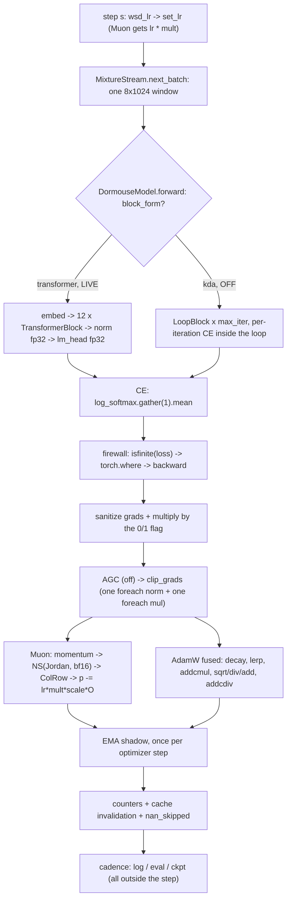

# The training step, end to end — the live lane

**Provenance.** Every `path:line` is at commit `eb285e3` (HEAD, 2026-11-08);
`git show eb285e3:<path>` reproduces every one of them. Three cited files —
`port/src/dormouse/train/loop.py`, `port/src/dormouse/config.py`,
`port/src/dormouse/cli.py` — carry uncommitted edits in the working tree as this
is written, and `loop.py` was still moving while it was written, so a number read
back from the tree will be off. The symbol named beside every citation is the
stable anchor. No number in §5 was measured for this document: each one names the
run that produced it.

**What this describes.** One optimizer step of the recipe that runs today:
`port/configs/flagship3_dense.toml` — 95 035 200 params, 12 pre-LN blocks,
`block_form="transformer"` (`port/configs/flagship3_dense.toml:21-31`) — with the
post-preset values `port/scripts/train_budget.sh:43-52` applies. This is the
Python/PyTorch lane. The Rust lane is `CONTEXT.md`'s subject; the **loop form**
(KDA/CSA/mHC/AttnRes/Engram/MoE) appears here only as the off side of the
dispatch in §2.2.

**Вердикт.** Шаг — это 12 одинаковых pre-LN блоков, один CE, один backward,
один Muon + один AdamW. Всё, чем этот репозиторий был знаменит (loop, KDA, CSA,
mHC, Engram, MoE), в живом рецепте выключено, и выключено по измерению, а не по
вкусу (§4). Единственная часть шага, которую стоит трогать первой, — оптимизатор:
на fp32-Newton–Schulz он был больше половины шага, и `ns_dtype=bf16` убрал его
почти целиком (§5).

---

## 1. The configuration a step belongs to

| knob | live value | where |
|---|---|---|
| `block_form` | `transformer` (12 unique blocks, pre-LN, RoPE, SDPA, GELU FFN) | `port/configs/flagship3_dense.toml:29-31` |
| width / depth / ffn | `d_model=832`, `n_layers=12`, `d_ffn=3072`, `n_heads=13`, `head_dim=64` | `port/configs/flagship3_dense.toml:21-24` |
| precision | `bf16=true`; the residual is fp32, the final norm + head are fp32 | `port/configs/flagship3_dense.toml:43`, `port/src/dormouse/model/model.py:1405-1406` |
| batch / seq / accum | 8 × 1024 × 1 = **8192 bytes per step** (1 byte = 1 position) | `port/scripts/train_budget.sh:43-46` |
| LR | WSD, `lr=3e-4`, `min_lr_frac=0.1`, warmup in tokens | `port/scripts/train_budget.sh:44`, `port/src/dormouse/train/lr.py:30-69` |
| optimizer | `opt=mix` (Muon on 2-D, AdamW elsewhere), `muon_lr_mult=12`, `muon_lr_mode=uniform` (schema default) | `port/scripts/train_budget.sh:44`, `port/src/dormouse/config.py:2040`, `:2058` |
| Muon precision | `ns_dtype=bf16`, `muon_state_dtype=bf16`, `ns_steps=5`, `ns_kind=classic` | `port/scripts/train_budget.sh:49`, `port/src/dormouse/config.py:1957`, `:1984`, `:2020`, `:2065` |
| AdamW | `betas=(0.9,0.95)`, `eps=1e-8`, `wd` from the config | `port/src/dormouse/train/optim.py:1846`, `port/src/dormouse/config.py:1814` |
| clip | `grad_clip=1.0`, `agc_clip=0.0` (AGC off) | `port/src/dormouse/config.py:1797`, `:1806` |
| EMA | `ema_decay=0.999`; eval and the served checkpoint read the shadow | `port/scripts/train_budget.sh:52`, `port/src/dormouse/train/loop.py:1481-1493` |
| eval window | 196 608 scored bytes (`eval_bytes`), from a file no training source reads | `port/src/dormouse/config.py:1930`, `port/src/dormouse/train/loop.py:1201-1209` |
| off | `ce_fixed`, `logit_softcap`, `z_loss`, `segment_len`, `torch_compile`, `opt_graph`, `full_graph`, `doc_masking` | `port/src/dormouse/config.py:1828`, `:1407`, `:1387`, `:2404`, `:1965`, `:2320` |

---

## 2. The step, in order

### 2.1 The schedule

`wsd_lr` is called at the top of the step (`port/src/dormouse/train/loop.py:1776-1783`)
and the Muon half may take a different value under `muon_sf` (`:1784-1802`). Both
halves are written by **`MixOptimizer.set_lr`** and by nothing else
(`port/src/dormouse/train/optim.py:1908-1941`): the Muon group gets
`muon_lr * muon_lr_mult` (`:1940`). The reason it is a method and not two inline
loops is a measured defect — until 2026-11-07 both call sites wrote the AdamW LR
into every group, so `muon_lr_mult` was **inert** and an 8× A/B measured the knob
off (`docs/records/reviews/2026-11-07-muon-audit.md:31`, `port/src/dormouse/train/optim.py:1912-1918`).

### 2.2 Data

`opt.zero_grad` first, then one Python loop over `grad_accum` micro-batches
(`port/src/dormouse/train/loop.py:1888-1918`; live `grad_accum=1`). Each draw is
`stream.next_batch()` (`:1906`), one `[8, 1024]` window of inputs and the byte
after each position (`port/src/dormouse/train/data.py:290-293`). `MixtureStream`
picks the source from the micro-batch index and **increments that index**
(`port/src/dormouse/train/mixture.py:593-605`); the index is the whole cursor
(`:579-582`). `doc_masking` is off live; when on it takes `next_batch_masked`
(`:607-614`) and a `[b,t]` mask.

### 2.3 Forward, and the dispatch that matters

`DormouseModel.forward` (`port/src/dormouse/model/model.py:723-856`) has three
top-level shapes; the live one is the third (`:806-834`), which lands in
`_forward_byte_lm` (`:989`) and there splits on `block_form`:

| form | path | objective |
|---|---|---|
| `transformer` (**live**) | `embed → 12 × TransformerBlock → norm(fp32) → lm_head(fp32)` (`port/src/dormouse/model/model.py:1365-1382`, `:1405-1406`) | one final CE (`:1412`) |
| `kda` (off) | `embed → prelude → LoopBlock × max_iter → coda → norm → head` (`:1021-1107`) | `(Σ CE_i + CE_final) / (T+1)` (`:1213`), L_Rec accumulated **inside** the loop |

The block is one pre-LN decoder: packed `qkv`, RoPE on `head_dim`,
`F.scaled_dot_product_attention(is_causal=True)`, GELU FFN, GPT-2 residual
scaling (`port/src/dormouse/model/transformer.py:133-267`). No dropout, no
sampled arm, no bias on the projections: **the live forward consumes no RNG at
all.**

### 2.4 Loss, and the firewalls around it

Live path: `_byte_ce` → `-log_softmax(logits).gather(1, targets).mean()`
(`port/src/dormouse/model/model.py:1499-1520`). Three arms change it, all off:

| arm | what it does | where |
|---|---|---|
| `ce_fixed` | the paper's fixed CE: the target term is kept OUT of the softmax denominator; `loss = log1p(s·exp(u))` in **fp32**, and the target gradient is **defined** as `-(sum of the others)` instead of `q_t − 1` | `port/src/dormouse/losses.py:129-174`, `:177-215` |
| `logit_softcap` | `cap·tanh(z/cap)`, applied to the logits the CE reads; a non-finite logit stays non-finite so the trainer's firewall still owns it | `port/src/dormouse/losses.py:70-97` |
| `doc_masking` | one document per row, `[b,t]` mask; the reduction is a mean over selected positions | `port/src/dormouse/model/loopblock.py:171-181`, `port/src/dormouse/model/model.py:1415-1421` |

The three firewalls inside `ce_fixed`, in order of when they bite:

1. the dtype cliff — `CLIFF[fp32]=16.6` nats is the margin past which the
   standard path's target gradient rounds to exactly 0
   (`port/src/dormouse/losses.py:40-48`), counted per window as
   `ce_cliff_tokens` (`port/src/dormouse/losses.py:167`, printed by `port/src/dormouse/train/loop.py:155-167`);
2. the exponent band `u ∈ [−103, 80]`, outside which an algebraically equal
   branch is taken and the branch is counted (`port/src/dormouse/losses.py:50-55`,
   `:144-146`, `:168`);
3. a non-finite **target logit** is forwarded as non-finite rather than read as a
   perfect prediction, so the NaN firewall in §2.5 decides (`:151`).

The cap is *not* a cliff fix and does not claim to be: `2·cap = 30` nats at
`cap=15` is still above fp32's 16.6 (`port/src/dormouse/losses.py:75-79`).

### 2.5 Backward and the gradient firewall

`port/src/dormouse/train/loop.py:1611-1673` (`micro_step`), in this order:

1. `loss_finite = torch.isfinite(loss.detach()).all()`;
   `step_loss = torch.where(loss_finite, loss, 0)` — on a healthy step the value
   **and its gradient are bit-identical** to a bare `loss.backward()`
   (`:1634-1636`);
2. `/ n_micro` so that `grad_accum=k, batch=b` has the mean gradient of
   `batch=b·k` (`:1637-1641`);
3. `step_loss.backward()` (`:1646`);
4. one vector norm over every `.grad` answers "did any go non-finite" without a
   host read; `finite = loss_finite & isfinite(raw_norm)` (`:1652-1655`);
5. the flag: a fresh write for one micro-batch, an AND for many (`:1656-1665`);
6. **the gradient firewall**: `nan_to_num_` every gradient, then ONE
   `torch._foreach_mul_` per dtype with the 0/1 flag (`:1671-1672`,
   `port/src/dormouse/train/loop.py:80-99`).

Why step 6 exists at all when step 1 already masked the loss: a NaN that entered
through an *activation* survives the Jacobian, and `NaN·0` is still NaN
(`:1648-1651`). A masked loss alone is not a skipped step.

**The `sign` in this repo is not here.** LFB's controller step is
`b_e ← b_e − coef·sign(L_e − mean L)` (`port/src/dormouse/model/experts.py:1869-1871`, the sign branch at `:1870`),
where `L_e` is the routed-token count. It is not a gradient, it is not multiplied
by this flag, and it runs in the **forward**, not in the backward: `lfb_bias` is a
non-persistent buffer so the optimizer never sees it, and it travels in the
checkpoint's `moe` section (§3). It is off in the live preset twice over:
`moe_lb_coef=0.0` makes the controller's step zero and `_lfb_step` returns before
it accumulates (`port/src/dormouse/config.py:1108`,
`port/src/dormouse/model/experts.py:1854-1856`), and `n_experts=1` forces
`topk=0`, so there is nothing to balance
(`port/src/dormouse/model/experts.py:1510-1511`).

### 2.6 Clip and AGC

`opt_stage()` (`port/src/dormouse/train/loop.py:1561-1586`) is the whole
optimizer stage, and it is one callable so that a CUDA-graph capture records
*this* and not a second definition of it:

1. `agc_clip` — off at 0.0; per-tensor `λ·‖p‖/max(‖g‖,ε)`, three `_foreach_*`
   launches, device-only (`port/src/dormouse/train/optim.py:2364-2410`);
2. `clip_grads` — one `_foreach_norm` + one fused multiply, replacing
   `clip_grad_norm_`'s per-tensor walk (measured 252 ms/step on `small` at
   2 920 norm calls, `port/src/dormouse/train/optim.py:2413-2431`);
3. `opt.step(flag_dev)`.

AGC runs **first** because it needs the accumulated gradient after every
micro-batch and must bound each parameter's direction before the global norm
decides the step's size (`port/src/dormouse/train/loop.py:1572-1575`).

### 2.7 Muon — the half that gets 2-D parameters

`MixOptimizer.step` → `Muon.batched_step_from_model`
(`port/src/dormouse/train/optim.py:2008-2084`, `:1329-1543`). Membership is a
name+shape rule, not "all 2-D": embeddings, `lm_head`, controllers/routers and
hashed tables stay on AdamW (`:1667-1689`). Per shape group:

| stage | arithmetic | where |
|---|---|---|
| momentum | `M ← μM + (1−μ)G`, `μ=0.95`; fp32 accumulate, optional bf16 store | `:1163-1169`, `:1425-1434` |
| NS polar | the **Jordan** triple `(3.4445, −4.7750, 2.0315)`, 5 iterations, Frobenius prescale, transposed when tall so the Gram is the `[r,r]` of the smaller side | `:100`, `:225-301` |
| ColRow | columns then rows, so every row of the update has norm 1 | `:457-512`, applied at `:1182` |
| shape scale | `uniform`: `sqrt(max(1, rows/cols))`; `shape_fair`: `sqrt(cols)` so `RMS(ΔW) = lr` on every shape | `:1122-1136` |
| write | `p.add_(update, alpha = −lr·scale)`, with `lr` already carrying `muon_lr_mult` | `:1191-1204` |

The bf16 rungs are the live ones: `ns_dtype=bf16` runs the polynomial on tensor
cores with explicit fp32 in/out casts, `muon_state_dtype=bf16` halves the
momentum storage. Both are approximate by design; stochastic rounding is named
as the unimplemented follow-up (`port/src/dormouse/train/optim.py:30-56`).

### 2.8 AdamW — the fused writer

`_foreach_adamw_step` (`port/src/dormouse/train/optim.py:2117-2185`). Its reason
to exist is not speed of arithmetic but the removal of **528 host reads** (one
per parameter's `step` scalar, `:2120-2127`). The statements are torch's, in
torch's order:

| step | line |
|---|---|
| one `_adamw_t += 1` for the whole optimizer, then `t` is the Python int | `:2141-2142` |
| decoupled decay `p *= (1 − lr·wd)`, replaced by the 1.0-preserving `where` on a skipped step | `:2160-2169` |
| `exp_avg.lerp_(g, 1−β1)`; `exp_avg_sq *= β2; += (1−β2)·g²` | `:2172-2174` |
| the skip zeroes the first moment and lets the second keep decaying | `:2175-2179` |
| bias correction from the Python int; `denom = sqrt(v)/sqrt(1−β2^t) + eps`; `p.addcdiv_(m, denom, −lr/(1−β1^t))` | `:2180-2185` |

`_fast_adamw_ok` (`:2086-2114`) is the precondition gate; anything it refuses
falls back to `_gated_adamw_step` (`:2188-2250`), a fallback that is COUNTED by
construction, not silent.

### 2.9 EMA

Once per **optimizer** step, after the update landed
(`port/src/dormouse/train/loop.py:1947-1951`):
`shadow ← d·shadow + (1−d)·param`, with the firewall flag as the lerp weight so a
skipped step leaves the shadow exactly where it was
(`port/src/dormouse/train/loop.py:850-871`). Eval and the served checkpoint read
the shadow; a resume continues the raw iterate, because the optimizer moments
belong to those weights (`port/src/dormouse/train/loop.py:433-439`).

### 2.10 Counters, caches, and the cadences

| what | where |
|---|---|
| `nan_skipped` counted as a **device** counter (`1 − flag_dev`), drained later | `port/src/dormouse/train/loop.py:1944-1945` |
| bank + QAT-projection caches invalidated every trained step (a graph replay does not bump `_version`) | `port/src/dormouse/train/loop.py:1963-1964` |
| `opt.counters` merged and cleared (the Muon arms' own `ns_triton` / fallback reason) | `port/src/dormouse/train/loop.py:1974-1983` |
| `g_norm_muon` / `g_norm_adamw` / `g_norm_norms_biases` measured **once per log window**, on the `.grad` the step just consumed | `port/src/dormouse/train/loop.py:2007-2009` |
| ONE batched drain of every device counter, then ONE loss read | `port/src/dormouse/train/loop.py:2014`, `:2027` |
| the log line | `port/src/dormouse/train/loop.py:2028-2056` |
| eval (frozen, rewound window) and checkpoint (atomic write), outside the step | `port/src/dormouse/train/loop.py:2083-2114` |

---

## 3. The state that survives a step

A table, because "what a resume must restore" is the question a new feature gets
wrong first. The file format itself has its own reference in
`docs/architecture/checkpoint-format.md` (a sibling document, in flight as this
is written); this table is the *step's* view of it — what a change has to touch,
not what the payload contains.

| state | where it lives | in the checkpoint? | a new feature must |
|---|---|---|---|
| parameters | `model.state_dict()` | yes — key `model`, plus `model_ema` when EMA is on (`port/src/dormouse/train/loop.py:450-463`) | add the parameter in both halves; `ck["model"]` must stay exactly `state_dict()`-shaped |
| Muon momentum | `Muon.state[p]["momentum"]`, one tensor per parameter, a **view** into one stacked `[N,d0,d1]` buffer per (group, shape) (`port/src/dormouse/train/optim.py:970-1070`) | yes, per-parameter; `_build_groups` re-stacks on load (`:1072-1077`) | nothing, unless the parameter changes shape-group membership |
| AdamW moments | `state[p] = {exp_avg, exp_avg_sq, step}` (`port/src/dormouse/train/optim.py:2152-2156`) | yes | nothing |
| `_adamw_t` | a Python int on `MixOptimizer` (`port/src/dormouse/train/optim.py:1874`) | **derived, never stored** — recovered from one parameter's `step` on load (`:2307-2316`) | keep it equal to torch's step; see invariant I4 |
| `opt.steps` | `MixOptimizer.steps` | yes, `opt["steps"]` (`:2294-2299`) | bump it where the optimizer steps, not where the loop iterates |
| EMA shadow | `port/src/dormouse/train/loop.py:1481-1483`, one tensor per parameter | yes, key `model_ema` (`:462-463`) | a new parameter must be shadowed, or `_shadow_state` refuses on the next resume (`:795-807`) |
| LFB bias | `SparseMoE.lfb_bias`, a **non-persistent** buffer (`port/src/dormouse/model/experts.py:1421-1423`) | yes — in the `moe` section, *outside* `model` (`port/src/dormouse/train/loop.py:460`) | add it to `lfb_state`/`_restore_lfb`; a training load of a file with counts but no bias is LOUD (`:308-347`) |
| LFB counts | `SparseMoE.lfb_counts`, a **persistent** buffer (`port/src/dormouse/model/experts.py:1428-1430`) | yes, inside `model` | nothing |
| data cursor | `MixtureStream._step` (`port/src/dormouse/train/mixture.py:579-582`) + each source's `_idx`/`_off` (`port/src/dormouse/train/data.py:298-301`) or `_pos` (`:419`) | **no** | never store it; a resume replays exactly `start·(seq+1)·batch·grad_accum` bytes and asserts the cursor (`port/src/dormouse/train/loop.py:1444-1449`) |
| RNG | process seed applied once, before a fresh model (`port/src/dormouse/cli.py:178-191`) | only the seed, in the config snapshot | never draw from a global RNG in a step; every per-step random decision must be a pure function of `(seed, step)` (`port/src/dormouse/train/loop.py:765-777`) |
| host n-gram tables | `<ckpt>.ngram`, a **sibling file** (`port/src/dormouse/train/loop.py:174-186`, `:467-475`) | a file, not a key | only on the `engram_ram` arm; a missing sibling is LOUD (`:541-556`) |
| storage rung | top-level `model_quant_rung` (`port/src/dormouse/train/loop.py:454`) | yes | a packing change must bump or refuse the rung (`:480-501`) |
| config snapshot | `<ckpt>.config.toml` beside the weights (`port/src/dormouse/train/loop.py:476`) | yes | a new field is drift-checked on resume unless it is a `PROGRESS_KEYS` member (`port/src/dormouse/config.py:49-104`) |

---

## 4. The arms that exist and are OFF

The live preset turns every one of these off. For the first six the reason is the
same measurement; the per-arm line is what the arm's own A/B said.

| arm | flag | state | why off, with the measurement |
|---|---|---|---|
| **KDA** (gated-delta attention, the only attention arm in the repo) | `use_kda` | off | a 13.5M dense decoder beat the 102.7M KDA/CSA/mHC/Engram block by **0.126 BPB on 8/8 eval windows** at matched bytes, 0.12–0.37 across the report's frames (`docs/records/reviews/2026-11-06-control-transformer.md:14-19`, `:274`). It is also unreachable on this form: `validate_block_form` refuses the flag (`port/src/dormouse/config.py:3231-3234`) |
| **CSA** (coarse/fine sparse attention) | `use_csa` | off | 786 435 params, 7.1 ms/step (4.0 % of the step), **−0.011 BPB with no spread = a tie**; "delete at 1 KB" (`docs/records/reviews/2026-11-05-architecture-review-dense.md:196`, `:290-293`, `:319`) |
| **mHC** (multi-lane residual) | `use_mhc` | off | it *won* on the loop — −0.078 at 142M (`docs/records/reviews/2026-10-23-architecture-verdict.md:34`) — but on a 142M **MoE**, at +40 % VRAM, with **no dense ablation at all** (`docs/records/reviews/2026-11-05-architecture-review-dense.md:318-319`) |
| **AttnRes** | `use_attnres` | off | −0.050 at 142M MoE on a 3.3× spread, "unmeasured" on dense (`docs/records/reviews/2026-11-05-architecture-review-dense.md:194`); the dense stack has no per-iteration slots to attend over (`port/src/dormouse/config.py:3231-3234`) |
| **Engram** (hashed n-gram input tables) | `use_engram` | off | best buy per MAC (+2.306 BPB when ablated) but it is **half the parameters and a lookup table, not capacity** (`docs/records/research/2026-11-07-tsct-ceiling.md:68`); "79 % of the parameters, zero clean evidence" (`docs/records/reviews/2026-11-05-architecture-review-dense.md:244`), and the only comparison on record was scored by a memory-disabled eval, so the verdict was never run (`AGENTS.md` §3.2) |
| **MoE** (TSCT expert bank) | `n_experts`, `moe_topk`, `use_tsct` | `1`, `0`, `false` | +0.067 BPB for 44.8M params — 43.6 % of the model buying 0.067 (`docs/records/research/2026-11-07-tsct-ceiling.md:68`) — and the load-balancing controller collapsed: 9 of 512 experts ran, one holding 4096 of 8192 assignments (`docs/records/reviews/2026-11-04-routing-collapse-CONFIRMED.md:12`, quoted at `port/src/dormouse/train/loop.py:335-341`) |
| **`torch.compile`** | `torch_compile` | off | 285 ms/step against the control's 283 at the live shape, i.e. **1.00×** (`docs/architecture/2026-11-08-the-16x.md:30`, `:36`); on the MoE form it was 0.20× because of data-dependent cache guards (`docs/records/reviews/2026-10-23-architecture-verdict.md:77`) |
| **CUDA graphs** (`opt_graph`, `full_graph`) | `opt_graph` / `full_graph` | off | 286 ms vs 283, **0.99×** (`docs/architecture/2026-11-08-the-16x.md:37`). `full_graph` would also refuse **this** config on its own: it runs the EMA update eagerly outside the capture, so a capture would re-apply the capture step's delta on every replay — `ema_decay=0.999` is a LOUD refusal (`port/src/dormouse/train/graph.py:661-668`), and `full_graph_refusal` refuses every arm it cannot replay (`:569-758`) |
| **segmented forward** | `segment_len` | 0 | it is a **memory** decision that may not move a model boundary (`docs/records/reviews/2026-11-08-segment-csa.md:10-14`); at 8192 bytes/step there is no VRAM to save, and a capture refuses it (`port/src/dormouse/train/graph.py:633-639`) |

Three more arms exist on the same step and are also off:

| arm | flag | state | why |
|---|---|---|---|
| `ce_fixed` | `ce_fixed=false` | off | every number on record is the historical line, bit for bit (`port/src/dormouse/config.py:1828`, `port/src/dormouse/model/model.py:1510-1512`) |
| `logit_softcap`, `z_loss` | `0.0` | off | both are stability arms with no measurement on this lane yet (`port/src/dormouse/config.py:1387`, `:1407`) |
| `muon_lr_mode=shape_fair` | `uniform` | off | it multiplies the step by ~`sqrt(cols)` (28.8× on `[832,832]`, 55× on `[832,3072]`), which is a bigger change than the measured optimum `muon_lr_mult=12`; the default stays `uniform` until the arm's own A/B lands (`port/src/dormouse/config.py:2042-2058`, `docs/records/reviews/2026-11-07-muon-audit.md:31`) |

**Вердикт.** Каждая строка — это измерение, а не мнение, и у четырёх из них один
и тот же источник: плотный контроль 2026-11-06. Читать таблицу как «механизмы
плохие» нельзя — mHC и AttnRes выиграли на loop-форме; они проиграли вместе с
формой, которая их несёт, и на плотном теле никто их не мерил.

---

## 5. Where the time goes

Three instruments, three different questions. None of them is a substitute for
another.

### 5.1 The arm-level ladder — the optimizer is the lever

Measured, one script, 40 steps per arm, `b=8 s=1024`, 95 035 200 params, arms run
minutes apart on one card (`/home/sehaxe/logs/thru/*.jsonl`, tabulated at
`docs/architecture/2026-11-08-the-16x.md:30-37`). Recomputed from `tokens_per_s`
the same rows read 290 / 150 / 221 / 140 ms — within 3 %, which is why §7 keeps
the absolute open.

| rung | ms/step | vs control | BPB @ 16.4 MB |
|---|---:|---:|---:|
| `muon_fp32` (control, every number before 2026-11-08) | 283 | 1.00× | 2.0263 |
| `muon_state_dtype=bf16` alone | 285 | 1.00× | 2.0182 |
| `ns_dtype=bf16`, 5 steps | 147 | **1.89×** | 2.0325 (+0.006) |
| `ns_steps=3`, fp32 | 216 | 1.23× | 2.3001 (+0.274) |
| `ns_steps=3` + bf16 NS | 136 | 2.08× | 2.2873 (+0.261) |
| `torch_compile=true` | 285 | 1.00× | — |
| `opt_graph=true` | 286 | 0.99× | — |

Two readings from it, both load-bearing:

- **bf16 NS is a free 1.89×, `ns_steps=3` is not free.** The fp32 chain is
  579 GFLOP/step on the CUDA-core lane (`port/scripts/throughput_ladder.sh:11-14`);
  bf16 moves the same polynomial to the tensor cores. Three iterations instead of
  five costs **+0.274 BPB** at 16.4 MB, reproduced in both dtypes — the published
  "non-monotone, a tie" result does not transfer to `[832,3072]` with a dense
  spectrum (`docs/architecture/2026-11-08-the-16x.md:41-49`).
- **compile and graphs buy nothing here**, and that is a measured zero on the
  *same* ladder, not an opinion (`docs/architecture/2026-11-08-the-16x.md:53-57`).

### 5.2 The split at the live rung

Measured at `b=8 s=1024` after the NS fix. The split is recorded in the
launcher's header, not in a committed log (`port/scripts/batch_sweep.sh:4-6`):

| stage | ms/step | share | tag |
|---|---:|---:|---|
| model forward + backward (12 blocks, fp32 head/CE) | 104 | 76 % | measured |
| optimizer stage (`clip_grads` + Muon + AdamW) | 32 | 24 % | measured |
| total | 136 | 100 % | measured |

Cross-check, computed: the forward+backward bill is 691.37 MFLOP/byte
(`port/configs/flagship3_dense.toml:14`) × 8192 B = **5.66 TFLOP/step**, so
104 ms is **54.4 TFLOP/s**, which the launcher states as ≈62 % of the card's bf16
peak (`port/scripts/batch_sweep.sh:5`). The number is self-consistent, which is
the only thing a derived figure can be.

### 5.3 The region attribution, on the form that has regions

The only kernel-attributed profile on record is the **loop** config (`m400b`,
step 320 ms, b8×s1024), so it prices what the live step does not contain. It is
still the only answer to "which region", and its largest region is the same one:

| region | ms/step | share |
|---|---:|---:|
| optimizer | 35.4 | 23.5 % |
| moe_dispatch | 31.6 | 21.0 % |
| mhc_write | 23.2 | 15.4 % |
| other | 18.0 | 11.9 % |
| kda (recurrent + proj) | 15.0 | 10.0 % |
| attnres | 6.5 | 4.3 % |
| clip | 5.8 | 3.9 % |
| engram | 5.5 | 3.7 % |
| csa (fine + coarse) | 7.1 | 4.7 % |
| moe_gemm | 1.3 | 0.9 % |

`docs/records/reviews/2026-11-05-kernel-profile.md:23-36`. The same profile reports
**GPU busy 200 ms of a 401 ms profiled wall**, i.e. ~50 % host idle — and 4 692
launches per step (`docs/records/reviews/2026-11-05-kernel-profile.md:15-18`).

**Вердикт.** На живом рецепте шаг — это 76 % арифметики модели и 24 %
оптимизатора, и оптимизатор в этой доле уже на быстром rung'е: на fp32-NS он был
больше половины шага (283 против 147 — это 136 ms, ровно цена fp32-цепочки).
Поэтому «оптимизировать шаг» здесь значит: сначала rung, потом всё остальное.
Compile и graphs уже измерены как ноль **на этом** шаге; они лечат запуски, а шаг
на быстром rung'е упирается в арифметику модели.

---

## 6. The invariants a change must not break

| # | invariant | what enforces it | what breaks if it goes |
|---|---|---|---|
| **I1** | **0-sync:** no host read decides a step. `_host_scalar` is the only read, and only on the log/report cadence | `port/src/dormouse/train/loop.py:69-77`, `:2027`; gates `port/tests/test_nan_firewall.py:138`, `port/tests/test_step_audit.py:141` | a per-step D2H serialises the CPU against the GPU on every step; the 0-sync claim becomes a ratio nobody measures |
| **I2** | **Loss firewalls:** a non-finite loss AND a non-finite gradient both skip the step, on device, and a healthy step is bit-identical | `port/src/dormouse/train/loop.py:1634-1672`; gate `port/tests/test_nan_firewall.py:91` (bit-identical), `:107`, `:248` | a `NaN·0` through an activation poisons the moments; or a host branch on the flag reintroduces I1's sync |
| **I3** | **Drowning stop:** two consecutive windows in which every step was non-finite stop the run | `port/src/dormouse/train/loop.py:2072-2081` | a run that trains nothing exits 0 — the failure this rule exists for |
| **I4** | **`_adamw_t` == torch's step.** The fused writer's bias correction reads the Python int; the fallback bumps it; the load recovers it from one parameter's `step` | `port/src/dormouse/train/optim.py:2141-2142`, `:2082-2083`, `:2307-2316` | measured: a 6-step capture fallback diverged **3.1e-05** at `embed.weight` while the losses agreed to nine digits — the forward matched, the update did not (`:2079-2081`) |
| **I5** | **The data cursor:** a resume reads UNSEEN bytes, exactly the ones an unbroken run would have read | `port/src/dormouse/train/loop.py:1444-1449`; `MixtureStream.skip_bytes` re-derives each source's share (`port/src/dormouse/train/mixture.py:631-679`); gate `port/tests/test_invariants_resume.py:135` (resume at 15 bit-identical to 30) | a resumed run re-reads and memorises the corpus head; every cross-run A/B becomes noise |
| **I6** | **The checkpoint key set:** `model`, `opt`, `step`, `model_quant_rung`, `moe`, optional `model_ema`. `ck["model"]` is exactly `state_dict()`-shaped; `moe` rides out of band | `port/src/dormouse/train/loop.py:450-463`, `:256-300`; gate `port/tests/test_resume.py:73` | a key that is not there is state lost between two files claiming one step count (the burn `7adda92` class) |
| **I7** | **The LFB bias travels.** A file with `lfb_counts` but no `lfb_bias` is a LOUD refusal on a training load, never a zero default | `port/src/dormouse/train/loop.py:308-347` | measured: 50 of 51 tensors differ after a 4+resume at `moe_lb_coef=0.01` (`:315`) |
| **I8** | **Config drift:** a resume refuses any differing key outside `PROGRESS_KEYS`, and the snapshot is written beside the weights | `port/src/dormouse/config.py:49-104`, `port/src/dormouse/train/loop.py:476`; gate `port/tests/test_resume.py:39` | extending a run is legal; changing the objective under one step count is not |
| **I9** | **The Muon LR is written only through `set_lr`** | `port/src/dormouse/train/optim.py:1908-1941` | a direct `group["lr"] = lr` silently disables `muon_lr_mult` — measured inert once already (`docs/records/reviews/2026-11-07-muon-audit.md:31`) |
| **I10** | **Every per-step random decision is `(seed, step)`**, never a global draw | `port/src/dormouse/train/loop.py:765-777`, `port/src/dormouse/cli.py:178-191` | a resume continues a different objective. The named exception is `ternary_s3t`, whose mask is process-local and does NOT survive a resume (`port/src/dormouse/train/loop.py:1256-1268`) |

---

## 7. What this document does not settle

1. **Two measurements of the same arm disagree by 1.8×.** The 40-step ladder puts
   the fp32-NS control at 283 ms/step (`docs/architecture/2026-11-08-the-16x.md:30`);
   the 14 648-step ladder control on the same preset at the same batch reads
   **164 ms/step**
   (`/home/sehaxe/logs/ladder/control_refetch.jsonl`, 49 813 tok/s at step 3 662,
   56 270 at 14 648 → 164 / 146 ms). No step-time claim above depends on that
   absolute: §5.1 is intra-ladder, §5.2 is a separate same-shape split. Until
   someone re-measures on a quiet card with a step index and a timer, **the
   absolute cost of a step is an open number** — which is exactly the burn lesson
   `AGENTS.md` §3.1 records.
2. **The eval and the checkpoint are not in this budget.** Both are serial and
   outside the step: ~0.95 s per eval window and ~2.1 s per checkpoint write
   (`docs/records/reviews/2026-11-08-cpu-perf-audit.md:17-19`). A run's wall clock is
   `steps × step` plus those, and the cadence policies decide which dominates.
3. **The working tree is ahead of this document.** Three cited files have
   uncommitted edits as this is written. Re-check a line number before trusting
   it; the symbol is the anchor.
4. **The live form has no arms to A/B**, which is the point and also the trap: the
   only mechanism a reader can add to this step without changing the
   architecture is an optimizer rung or a loss-term change, and both are
   precision/numerics decisions that need their own 3-seed arm (`AGENTS.md` §1.2).
